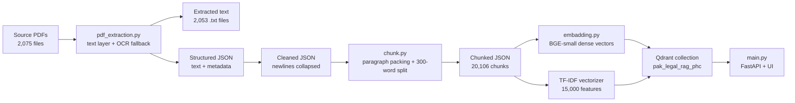
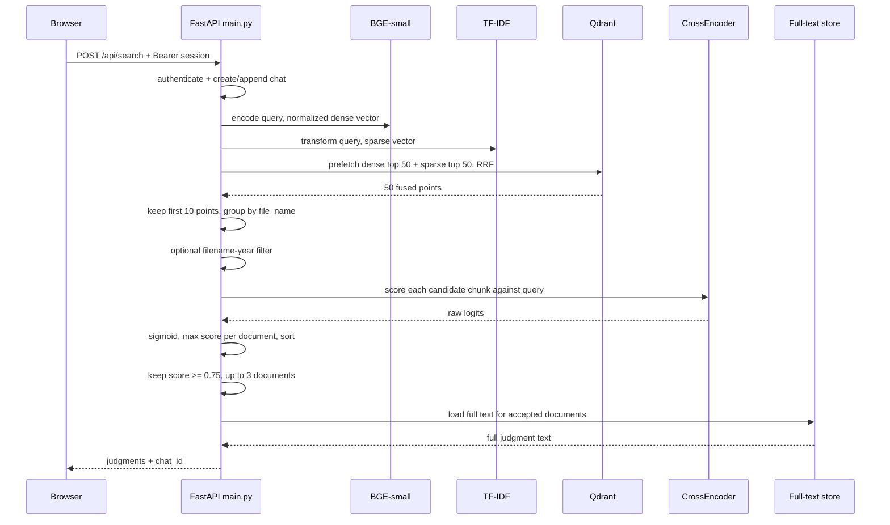
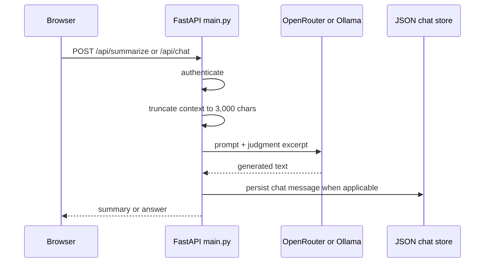

# Complete Project Technical Notes

**Project:** Peshawar High Court Criminal Judgment Legal RAG  
**Runtime snapshot:** 1 November 2026  
**Primary application:** `main.py`  
**Document purpose:** a beginner-friendly but implementation-accurate explanation of how this project works, what is actually running, how it was evaluated, and where its limits are.

> **Evidence convention used in this document**
>
> - **Verified implementation** means the statement comes from the current source code, current local data artifacts, or a read-only inspection of the running Qdrant instance.
> - **Concept** means general information-retrieval or machine-learning background needed to understand the implementation.
> - **Illustrative example** is synthetic and is not a real judgment, score, or evaluation result.
> - **Recommendation** means a possible improvement that is **not currently implemented**.
> - **Unknown / unverified** means the available evidence is insufficient for a factual claim.
>
> No secrets, passwords, session tokens, user e-mail addresses, or private uploaded document text are reproduced in this document.

---

## Contents

1. [Purpose, scope, and reading guide](#1-purpose-scope-and-reading-guide)
2. [Executive summary](#2-executive-summary)
3. [Repository map and source of truth](#3-repository-map-and-source-of-truth)
4. [System architecture](#4-system-architecture)
5. [Corpus and data artifacts](#5-corpus-and-data-artifacts)
6. [PDF extraction and metadata](#6-pdf-extraction-and-metadata)
7. [Cleaning and chunking](#7-cleaning-and-chunking)
8. [Dense and sparse embeddings](#8-dense-and-sparse-embeddings)
9. [Qdrant storage and indexing](#9-qdrant-storage-and-indexing)
10. [Retrieval pipeline](#10-retrieval-pipeline)
11. [Reranking, scoring, and thresholding](#11-reranking-scoring-and-thresholding)
12. [LLM summary and chat generation](#12-llm-summary-and-chat-generation)
13. [API, authentication, persistence, and UI](#13-api-authentication-persistence-and-ui)
14. [Evaluation](#14-evaluation)
15. [Configuration and tuning](#15-configuration-and-tuning)
16. [Installation, running, and reindexing](#16-installation-running-and-reindexing)
17. [Tests, verification, limitations, and unknowns](#17-tests-verification-limitations-and-unknowns)
18. [Glossary, source map, and maintenance](#18-glossary-source-map-and-maintenance)

---

## 1. Purpose, scope, and reading guide

### 1.1 What the system is for

The application is a legal research assistant over a collection of Peshawar High Court criminal judgments. A user can:

- register and log in;
- search the indexed judgment corpus using natural language or keywords;
- receive up to three judgment documents that pass a reranker score threshold;
- open the full judgment text, save it, summarize it, or ask questions about the specific judgment;
- upload a PDF, DOCX, or TXT file and search it alongside the main corpus;
- keep search and chat history in JSON-backed storage.

**Verified implementation:** the primary application is `main.py`. It serves both the FastAPI backend and an inline HTML/CSS/JavaScript frontend. The application runs on port `8001` by default (`main.py:3658-3661`).

### 1.2 The most important distinction: retrieval is not generation

The system has two different behaviours that are easy to confuse:

1. **Search/retrieval** finds whole judgment documents using dense embeddings, sparse TF-IDF vectors, Qdrant fusion, and a cross-encoder reranker. This path does **not** call an LLM.
2. **Summary and chat** call an LLM, but only for a judgment that has already been retrieved. The LLM is given at most the first `3,000` characters of the judgment text. It is not given the whole corpus and it is not asked to search.

The chat feature is therefore **document-grounded question answering over one selected judgment**, not a general RAG agent that retrieves fresh passages for each follow-up question. This is the single most important behavioural limitation to understand.

### 1.3 What this document covers

- the actual offline ingestion pipeline;
- the actual stored data and index;
- the actual runtime configuration at the snapshot date;
- the retrieval, reranking, and generation logic;
- the evaluation framework and why its archived numbers cannot be presented as current performance;
- security, privacy, operational, and data-quality limitations;
- a source map for future maintenance.

### 1.4 What this document does not claim

- It does not claim that the current 2,053-document index has been evaluated. It has not.
- It does not claim that the archived evaluation scores describe the current application.
- It does not claim that the system is production-ready or legally reliable.
- It does not expose or document the value of any secret.
- It does not replace a security review, legal review, OCR quality review, or user study.

### 1.5 Recommended reading order

- New to the project: sections 2, 4, 5, 10, and 11.
- Maintaining ingestion: sections 5, 6, 7, 8, and 9.
- Working on the API or UI: sections 12 and 13.
- Working on evaluation: sections 10, 11, and 14.
- Debugging a deployment: sections 15, 16, and 17.

---

## 2. Executive summary

### 2.1 One-sentence description

This is a FastAPI legal-search application that indexes about twenty thousand legal chunks in Qdrant using a 384-dimensional dense model plus a 15,000-feature sparse TF-IDF model, retrieves a small hybrid candidate set, reranks it with a cross-encoder, returns at most three documents above a score threshold, and offers optional LLM summaries and document-specific chat.

### 2.2 Verified runtime snapshot

| Item | Current value |
|---|---|
| Python interpreter used by this project | 3.10.14 (`./bin/python`) |
| Web framework | FastAPI, served by Uvicorn |
| Application port | `8001` |
| Qdrant server URL | `http://localhost:6333` |
| Current Qdrant collection | `pak_legal_rag_phc` |
| Current Qdrant points | 20,128 |
| Corpus chunks in index | 20,106 |
| Runtime uploaded chunks | 22 |
| Document-level points | 0 |
| Dense vector size | 384 |
| Dense distance | Cosine |
| Sparse vector name | `sparse` |
| Embedding model | `BAAI/bge-small-en-v1.5` |
| Reranker | `cross-encoder/ms-marco-MiniLM-L-6-v2` |
| Sparse model | TF-IDF, 15,000 features, n-grams `(1, 2)`, `min_df=2`, `sublinear_tf=True` |
| Retrieval mode | Dense + sparse prefetch, Qdrant RRF fusion |
| Prefetch limit | 50 per branch |
| Candidate points passed to reranker | 10 |
| Final `TOP_K` | 3 |
| Final score threshold | 0.75 |
| Device | CPU |
| Effective LLM provider | OpenRouter |
| Effective OpenRouter model | `poolside/laguna-s-2.1:free` |
| Configured Ollama model | `qwen2.5:7b-instruct` |
| Qdrant client / server versions | client `1.17.1`, server `1.20.0`; warning only, no observed search failure |

The count `20,128` is explained exactly at the snapshot: `20,106` corpus chunk points plus `22` runtime uploaded chunk points. The exact upload count can change as users upload files.

### 2.3 What is actually implemented

- PDF-to-text extraction with a PyMuPDF text-layer path and Tesseract fallback OCR.
- Heuristic metadata extraction for court, judge, parties, decision date, and decision status.
- Word-bounded, paragraph-aware chunking with a nominal `300`-word maximum.
- Dense BGE-small embeddings plus TF-IDF sparse vectors.
- A Qdrant collection with named `dense` and `sparse` vectors.
- Hybrid retrieval with Qdrant Reciprocal Rank Fusion (RRF).
- Cross-encoder reranking with sigmoid-normalized scores.
- Per-document maximum-score aggregation.
- A `0.75` threshold and top-3 output limit in the production search path.
- A limited query-expansion fallback for short homicide/property queries.
- Authentication, sessions, chat persistence, saved judgments, and file upload.
- An inline browser interface.
- A separate read-only evaluation retrieval core and an archived evaluation study.

### 2.4 What is commonly misunderstood

- **The archived accuracy is not current accuracy.** The archived baseline used a 74-document, 1,580-point index with 1,024-dimensional vectors. The current index has 2,053 documents, 20,128 points, and 384-dimensional vectors.
- **There are no document-level vectors in the current collection.** The `RERANK_INCLUDE_DOCUMENT_LEVEL` setting is `false`, and the collection has no `level="document"` points.
- **The UI percentage is the cross-encoder sigmoid score, not retrieval confidence or a calibrated probability.** A value of `0.75` does not mean “75% likely to be legally relevant.”
- **Chat does not run a new retrieval for every follow-up question.** It sends the selected judgment context and the question to the LLM.
- **The first 3,000 characters are not the whole judgment.** The LLM sees only the beginning of the text, even if the relevant part is later.
- **Uploaded documents are not tenant-isolated at the vector-search layer.** They carry `uploaded_by` metadata, but the retrieval filter does not use it.
- **The Qdrant collection can contain duplicate vectors if the indexer is rerun without recreation.** Corpus and upload points use random UUIDs rather than deterministic IDs.

### 2.5 The main practical caveat

Do not describe this system as having a measured current accuracy. The correct statement is:

> The application has an archived 74-document retrieval evaluation; the current 2,053-document index has not been re-evaluated, and the archived numbers are not directly comparable to the current models, collection, or candidate settings.

---

## 3. Repository map and source of truth

### 3.1 Source-of-truth order

When documents disagree, use this order:

1. Current source code: `main.py`, `config.py`, `rag_core.py`, ingestion scripts.
2. Current data artifacts: chunked JSON, extraction report, Qdrant collection metadata.
3. Current runtime configuration, excluding secret values.
4. Archived evaluation result files, only for historical context.
5. Older Markdown documents and code comments, which may describe an earlier BGE-M3/74-document setup.

### 3.2 File map

| Path | Role | How it runs | Authoritative for |
|---|---|---|---|
| `main.py` | FastAPI app, retrieval, reranking, upload, auth, history, inline UI | `./bin/python main.py` | Current production behaviour |
| `config.py` | Environment-based settings and data paths | Imported by app and scripts | Defaults and environment variable names |
| `pdf_extraction.py` | PDF to text, OCR fallback, structured and cleaned JSON | Manual pipeline | Extraction and metadata |
| `chunk.py` | Chunk creation and chunk metadata | Manual pipeline; executes at import | Chunk construction |
| `embadding.py` | Dense/sparse embedding and Qdrant upsert | Manual pipeline; executes at import | Index construction |
| `rag_core.py` | Read-only retrieval/evaluation core | Imported by evaluation and tests | Evaluation retrieval semantics, not production API semantics |
| `legal_rag_system.py` | Older/secondary implementation | Not imported by `main.py` | Historical/legacy behaviour only |
| `evaluation/` | Dataset, metrics, configurations, result artifacts | Manual evaluation | Historical evaluation evidence |
| `tests/` | Unit and integration-style tests | `unittest` | Current automated checks |
| `PHC_Criminal_Judgmentss/` | Source PDF corpus | Read by extraction | Source documents |
| `PHC_Criminal_Judgmentss_text/` | Extracted UTF-8 text and extraction report | Written by extraction | Cleaned source text |
| `PHC_Criminal_Judgments_structured.json` | Text plus extracted metadata | Written by extraction | Structured corpus |
| `PHC_Criminal_Judgments_cleaned.json` | Newline-collapsed text plus metadata | Written by extraction | Cleaning result |
| `PHC_Criminal_Judgments_chunked.json` | Chunk objects used for indexing | Written by `chunk.py` | Current chunk corpus |
| `sparse_vectorizer_phc.pkl` | Fitted TF-IDF vectorizer | Written by `embadding.py` | Sparse query/document encoding |
| `users_db.json`, `sessions_db.json`, `chat_sessions_db.json`, `saved_judgments_db.json`, `uploaded_documents_db.json` | Application persistence | Read/written by `main.py` | User/application state |
| `qdrant_db/meta.json` | Old embedded collection metadata | Not used by the current server setup | Legacy `pak_legal_rag_multi` only |
| `requirements.txt` | Pinned dependency list | Manual installation | Dependency versions |

### 3.3 Important code properties

- `chunk.py` and `embadding.py` run their whole pipeline at import time; they do not expose a `main()` or `if __name__ == "__main__"` guard.
- `main.py` uses `@app.on_event("startup")`, which is an older FastAPI lifecycle style.
- `main.py` duplicates retrieval logic that also exists in `rag_core.py`. They are not identical.
- `legal_rag_system.py` uses older defaults such as top-k `5` and threshold `0.60`; it is not the served application.
- The repository has no README; the dependency file is named `requirements.txt`.

### 3.4 Stale comments and names

The following are verified inconsistencies, not descriptions of current behaviour:

- `main.py` header says “Ollama (Local LLM)” and “GPU: NVIDIA RTX 3050”, while the effective provider is OpenRouter on this machine.
- `main.py:340` says the dense model is BGE-M3, but `config.py` uses BGE-small.
- `main.py:352` calls the sparse vectorizer “TF-IDF / BM25 style”; it is TF-IDF, not BM25.
- `config.py:96` says `auto` uses local Ollama when reachable; the actual code chooses OpenRouter when an OpenRouter key is present.
- `config.py:80-82` says `20` candidates was the best trade-off, while the current default is `10`.
- `save_db` claims atomic persistence, but writes directly with `open(..., "w")` and is not atomic.
- `rag_core.py` docstring mentions BGE-M3, but the current app uses BGE-small.
- `embadding.py` header and log messages mention BGE-M3, but it reads the configured BGE-small model.
- `main.py` summary/chat docstrings describe an earlier Ollama-model bug and still refer to `llama3:instruct`, while the effective model is configured separately.

---

## 4. System architecture

### 4.1 Offline ingestion architecture



The ingestion pipeline is offline. Starting `main.py` does not rebuild the corpus; it loads the already-fitted vectorizer, models, and Qdrant connection.

### 4.2 Online search request



### 4.3 Online summary/chat request



Search does not invoke the LLM. The LLM does not retrieve from Qdrant.

### 4.4 Logical layers

1. **Data acquisition:** PDFs and OCR.
2. **Data preparation:** metadata, cleaning, chunking.
3. **Representation:** dense vectors and sparse TF-IDF vectors.
4. **Storage:** Qdrant vector collection and JSON application stores.
5. **Retrieval:** hybrid candidate generation, grouping, reranking, thresholding.
6. **Interaction:** FastAPI endpoints, inline frontend, optional LLM generation.

### 4.5 Two retrieval implementations

| Path | Used by | Behaviour |
|---|---|---|
| `main.py` | Production API | Candidate points capped at 10; documents below threshold are not returned; no filename boost; query-expansion fallback exists |
| `rag_core.py` | Evaluation and tests | Configurable; if no result passes threshold, the top result can still be accepted; force-top fallback exists; filename boost exists |

This difference matters. The archived “production” evaluation was produced through `rag_core.py`-style logic, not by calling the live `/api/search` endpoint. Its threshold/fallback behaviour is therefore more permissive than the current production path.

---

## 5. Corpus and data artifacts

### 5.1 Current verified counts

| Artifact | Count / size |
|---|---:|
| PDF source files | 2,075 |
| Extracted text files | 2,053 |
| Documents in structured JSON | 2,053 |
| Documents in cleaned JSON | 2,053 |
| Chunks in chunked JSON | 20,106 |
| Unique source files in chunked JSON | 2,053 |
| Structured JSON size | 28,379,463 bytes |
| Cleaned JSON size | 27,526,593 bytes |
| Chunked JSON size | 41,272,792 bytes |
| Sparse vectorizer size | 10,092,922 bytes |
| Current Qdrant points | 20,128 |
| Corpus chunk points | 20,106 |
| Runtime uploaded chunk points | 22 |
| Document-level points | 0 |

### 5.2 Extraction report

The extraction report records:

| Field | Value |
|---|---:|
| PDFs found | 2,075 |
| Already extracted and skipped in that run | 0 |
| Pending in that run | 2,075 |
| Extracted successfully | 2,053 |
| Failed | 2 |
| Empty | 20 |
| Pages processed | 21,694 |
| Extracted characters | 26,758,993 |
| OCR pages | 6,710 |
| Elapsed time | 2,890.1 seconds |

The arithmetic is important:

```text
2,075 source PDFs = 2,053 successful text files + 2 failures + 20 empty results
```

The 20 empty results are PDFs where extraction produced no usable text; possible causes include failed OCR on page images, an image-only PDF, or unreadable content. The 2 failures are PDFs that raised an extraction error: one could not be opened and one had a corrupt page tree. Neither group became a text file.

### 5.3 Chunk word statistics

| Statistic | Value |
|---|---:|
| Chunks | 20,106 |
| Mean words per chunk | 215.81 |
| Median words per chunk | 240 |
| Minimum words per chunk | 1 |
| Maximum words per chunk | 300 |
| Chunk files | 2,053 |

The maximum equals the configured `300`-word cap. The minimum of `1` shows that short fragments and headings can survive as chunks.

### 5.4 Chunk-type distribution

The chunker assigns `chunk_type` with keyword rules and paragraph-number fallbacks:

| Chunk type | Chunks |
|---|---:|
| `headnote` | 5,607 |
| `legal_provision` | 3,367 |
| `arguments` | 3,365 |
| `judgment` | 3,001 |
| `body` | 1,939 |
| `reasoning` | 1,345 |
| `findings` | 796 |
| `facts` | 685 |
| `citation` | 1 |

These labels are heuristic. A chunk is assigned the first matching type in the dictionary order used by `detect_chunk_type`, so a chunk containing the word “section” may be labelled `legal_provision` even if that is not its main purpose.

### 5.5 Chunk-level metadata quality

The following counts are per chunk, not per unique document.

| Field | Missing / unknown chunks | Most common values |
|---|---:|---|
| `court` | 2,762 | Peshawar High Court 4,890; Peshawar 2,391; PESHAWAR HIGH COURT, PESHAWAR 2,233; MINGORA BENCH 1,655 |
| `decision_status` | 419 | `allowed` 11,434; `dismissed` 6,422; `acquitted` 1,083; `convicted` 547 |
| `judge_name` | 7,097 | Sahibzada Asadullah 498; Rooh ul Amin Khan 297; several spelling variants |
| `decision_date` | 9,829 | 22.04.2015 74; 09.04.2025 66; 17.06.2025 59 |
| `case_number` | 6,726 are `unknown_case` | Values include citation years such as `1995 SCMR 1345` |

The metadata is useful for inspection but should not be treated as a reliable structured database. In particular:

- `case_number` extraction can mistake a citation for a case number.
- `decision_status` is a substring search; `allowed` appears in many contexts.
- `decision_date` is frequently missing because the regex expects explicit phrases such as “decided on” or “announced on”.
- `judge_name` has spelling and line-break variants.

### 5.6 Legacy evaluation corpus

The archived evaluation used a different, smaller corpus:

| Legacy item | Value |
|---|---:|
| Old chunk file | `structure_dynamic_chunked.json` |
| Old chunks | 1,506 |
| Old documents | 74 |
| Old collection | `pak_legal_rag_multi` |
| Old points | 1,580 |
| Old dense size | 1,024 |
| Old dense distance | Cosine |
| Old sparse vector | `sparse` |
| Old labelled documents | 74 |

The old collection is described in `qdrant_db/meta.json`; the current app points at the server collection `pak_legal_rag_phc`. Do not confuse the two.

### 5.7 Data-lineage invariants

For the current data:

```text
2,075 PDFs
  -> 2,053 non-empty text files
  -> 2,053 structured documents
  -> 2,053 cleaned documents
  -> 20,106 chunks
  -> 20,106 corpus points
  -> 20,128 points after 22 uploaded chunks
```

If a count changes later, check whether extraction, chunking, or indexing was rerun. A change at one stage does not automatically propagate to the next stage.

---

## 6. PDF extraction and metadata

### 6.1 What PDF extraction is doing

A PDF is not necessarily a text document. It can contain:

- a real text layer, which can be selected and copied;
- scanned page images with no text layer;
- a mixture of both.

**Verified implementation:** `pdf_extraction.py` first asks PyMuPDF for the page text. If OCR is enabled and the stripped page text is shorter than `20` characters, it renders the page to a grayscale PNG and calls Tesseract with:

```text
tesseract <image> stdout -l eng --psm 3
```

The OCR settings are:

| Setting | Value |
|---|---|
| OCR enabled by default | `true` |
| OCR workers | `6` |
| OCR DPI | `250` |
| OCR minimum text threshold | `20` characters |
| OCR language | English |
| OCR page timeout | `180` seconds |
| Text preservation | `fitz.TEXT_PRESERVE_WHITESPACE` |

The OCR fallback replaces the page text only if the OCR result is longer than the original text layer. Otherwise the original text is kept.

### 6.2 Pipeline steps

`pdf_extraction.py` has three executable stages:

1. `extract_pdfs_to_txt()`: process PDFs and write `.txt` files.
2. `create_structured_json()`: read the text files and extract metadata.
3. `create_cleaned_json()`: collapse whitespace and write the cleaned corpus.

The pipeline is invoked by running:

```bash
./bin/python pdf_extraction.py
```

### 6.3 File discovery and skipping

- It lists only files ending in `.pdf` from `PDF_DIRECTORY`.
- It processes them in sorted filename order.
- If `LEGAL_RAG_SKIP_EXISTING_TEXT` is true and a non-empty output `.txt` already exists, it skips that PDF.
- It uses `ProcessPoolExecutor` with `OCR_WORKERS` workers.
- A failed or empty result is counted and recorded but does not stop the whole run.

### 6.4 Output text shape

Each successful extraction writes:

```text
<same stem as the PDF>.txt
```

The report is written to:

```text
PHC_Criminal_Judgmentss_text/_extraction_report.json
```

`create_structured_json()` then reads the `.txt` files and creates a list of records with this shape:

```json
{
  "metadata": {
    "file_name": "<judgment>.txt",
    "decision_date": "22.04.2015 or null",
    "judge_name": "name or null",
    "appellant": "name or null",
    "respondent": "name or null",
    "court": "court name or null",
    "decision_status": "allowed or null"
  },
  "text": "full extracted text"
}
```

### 6.5 Metadata rules

The extractor is heuristic. It uses:

- filename split on `vs`, `vs.`, or `versus` for parties;
- bracketed text or an uppercase court pattern for `court`;
- `Before <name>` or `Justice <name>` patterns for `judge_name`;
- `---Appellant` and `---Respondent` patterns;
- explicit date phrases such as “decided on”, “date of judgment”, or “announced on”;
- a first-match list for decision status, beginning with “Bail granted” and ending with “refused”.

This is not a legal metadata parser. It is a set of regular expressions over noisy OCR text. Its outputs should be treated as hints, not authoritative fields.

### 6.6 Cleaning behaviour

`clean_text()` in `pdf_extraction.py` does:

```python
text = re.sub(r'\n+', ' ', text)
text = re.sub(r'\s+', ' ', text)
text = text.strip()
```

**Verified consequence:** paragraph newlines are removed before chunking. The cleaned corpus is effectively one long line per document. The chunker therefore depends mainly on numbered-list detection, not on genuine paragraph boundaries. This is a major reason the chunking is best described as “paragraph-influenced,” not truly structure-preserving.

### 6.7 Failure and empty-result handling

- A failure is an exception during PDF handling.
- An empty result is a PDF that produced no text.
- Both are counted in the report.
- Neither creates a `.txt` file.
- A later run skips only files with an existing non-empty `.txt`; it does not automatically retry failed/empty PDFs unless those files are removed from the report logic or the extraction is rerun with the relevant output absent.

The report is the best source for identifying extraction gaps. The exact failed and empty filenames are listed in `_extraction_report.json`.

### 6.8 Extraction risks

- OCR errors propagate into metadata and retrieval.
- The OCR path is English-only.
- `tesseract` must be installed separately.
- Low-quality scans can produce empty pages.
- Text extraction can reorder columns or merge lines.
- Metadata regexes can match citations, headers, or footnotes.
- `decision_date` is missing for nearly half the chunks.
- `case_number` is often a citation rather than a true case number.
- The cleaning step removes paragraph structure before downstream processing.

---

## 7. Cleaning and chunking

### 7.1 Pipeline

`chunk.py` reads `CLEANED_JSON` and writes `CHUNKED_JSON`. Its executable top-level code runs at import:

```python
with open(INPUT_PATH, "r", encoding="utf-8") as f:
    data = json.load(f)
```

There is no CLI guard, so importing the module has side effects.

### 7.2 Paragraph detection

The current detector is:

```python
pattern = r'(\d+\.\s+.*?)(?=\s*\d+\.\s+|$)'
```

It looks for text starting with a number and a period, then captures until the next such number or the end of the document.

There is a fallback to splitting on double newlines, but because `clean_text()` already removed all newlines, that fallback almost never sees true paragraph separators in the current corpus.

Consequences:

- numbered legal paragraphs are a useful signal;
- dates such as `2015.` or citation numbers can be mistaken for paragraph starts;
- the chunker may split in unexpected places;
- “paragraph number” metadata is often just the first number at the start of a packed chunk, not the original judgment paragraph number.

### 7.3 Paragraph packing

`pack_paragraphs()` merges adjacent short paragraphs until adding another paragraph would exceed `300` words. It joins the packed text with newlines.

This reduces chunks that contain only a heading or a single short line. It also means a packed block can consist of several logically unrelated paragraphs.

### 7.4 Long-paragraph splitting and overlap

For a packed paragraph longer than `300` words:

```text
max_words = 300
overlap = int(300 * 0.10) = 30 words
step = 300 - 30 = 270 words
```

The split starts at word positions `0`, `270`, `540`, and so on. Each chunk contains up to `300` words. The last chunk may be shorter.

For a paragraph of `N` words where `N > 300`, the number of chunks is:

```text
floor((N - 1) / 270) + 1
```

**Illustrative example:** a 600-word packed paragraph produces:

- chunk 1: words 0-299;
- chunk 2: words 270-569;
- chunk 3: words 540-599.

Chunks 1 and 2 overlap by 30 words. Chunks 2 and 3 overlap by 30 words. The final chunk is only 60 words.

### 7.5 Important overlap limitation

The `10%` overlap applies **inside a packed paragraph that exceeds 300 words**. It does not create overlap between:

- two separately packed short-paragraph blocks;
- two different source documents;
- chunks that were already short enough.

So “10% overlap” is a parameter of the long-text splitter, not a corpus-wide guarantee.

### 7.6 Chunk metadata

Each chunk contains:

| Field | Meaning |
|---|---|
| `chunk_id` | Random UUID |
| `case_number` | Extracted from text or `unknown_case` |
| `text` | Chunk text |
| `metadata.file_name` | Source filename |
| `metadata.decision_date` | Hints from extraction |
| `metadata.judge_name` | Hints from extraction |
| `metadata.appellant` | Hints from extraction |
| `metadata.respondent` | Hints from extraction |
| `metadata.court` | Hints from extraction |
| `metadata.decision_status` | Hints from extraction |
| `metadata.chunk_type` | Heuristic label |
| `metadata.paragraph_number` | First number detected, or position |
| `metadata.chunk_index` | Index within the packed paragraph's split |
| `metadata.total_chunks_in_paragraph` | Number of splits |
| `metadata.word_count` | Word count |
| `metadata.document_index` | Document position in the corpus |

The Qdrant payload does **not** include the top-level `case_number` field. It includes the `metadata` object, so case-number filtering through Qdrant payload is not available in the current index unless the payload schema is extended.

### 7.7 Chunking risks

- The maximum is measured in whitespace-delimited words, not model tokens.
- A 300-word chunk can exceed the embedding model's 512-token limit.
- Short chunks as small as one word exist.
- Numbered-list detection can mistake legal citations for paragraph numbers.
- The chunk type is first-match keyword logic, not a trained classifier.
- Overlap is not applied to every chunk boundary.
- Re-running `chunk.py` generates new UUIDs, so chunk identities are not stable across runs.
- The chunker is not order-aware across the whole document; it processes packed paragraph blocks in sequence but metadata is local to each split.

---

## 8. Dense and sparse embeddings

### 8.1 Two representations of the same chunk

**Concept:** retrieval can use different notions of similarity.

- **Dense retrieval** maps text to a learned vector. It can match paraphrases and semantically related wording, but it may miss exact case numbers or rare names.
- **Sparse retrieval** represents text as weighted vocabulary entries. It is strong for exact words, names, citations, and statutory phrases, but it does not understand synonyms well.

The project indexes both representations for each chunk and combines them at query time.

### 8.2 Current dense model

| Setting | Value |
|---|---|
| Model | `BAAI/bge-small-en-v1.5` |
| Vector size | 384 |
| Distance | Cosine |
| Query normalization | `normalize_embeddings=True` |
| Indexing normalization | `normalize_embeddings=True` |
| Indexing max sequence length | `512` in `embadding.py` |
| Device | `cpu` |
| Batch size | 32 |

BGE-small is a bi-encoder: the query and document are encoded independently. This makes it possible to precompute document vectors and search them quickly. The trade-off is that the model does not see the query and document together.

The cosine similarity used by Qdrant is:

```text
cos(q, d) = (q · d) / (||q|| ||d||)
```

Because both vectors are normalized, the dot product and cosine similarity have the same ordering in this setup.

**Serving note:** `main.py` does not explicitly set `max_seq_length` on the embedding model. It relies on the model's configured default, which is 512 for BGE-small. `embadding.py` explicitly sets the configured value.

### 8.3 Current sparse model

**Verified implementation:** the sparse representation is TF-IDF, not BM25.

| Setting | Value |
|---|---|
| Vectorizer | `sklearn.feature_extraction.text.TfidfVectorizer` |
| Maximum features | 15,000 |
| N-grams | `(1, 2)` |
| Minimum document frequency | 2 |
| Sublinear term frequency | true |
| Default lowercasing | true |
| Norm | L2 by default |
| Fitted data | Training chunk texts |
| Persistence | `sparse_vectorizer_phc.pkl` |

With sublinear TF and smooth IDF, the weighting is conceptually:

```text
tf_weight(t, d) = 1 + log(count(t, d))          when count > 0
idf(t)         = log((1 + n) / (1 + df(t))) + 1
weight(t, d)   = tf_weight(t, d) * idf(t)
```

The vector is then L2-normalized. The exact implementation details are those of scikit-learn.

The sparse vector is stored as parallel index/value lists. It is not a dense 15,000-element array in Qdrant.

### 8.4 Why bigrams matter

Unigrams match individual words. Bigrams match two-word phrases such as “bail granted,” “section 302,” or a party name. This helps legal phrase matching but increases the feature space and memory cost. The `max_features=15000` cap limits that cost.

### 8.5 Indexing flow in `embadding.py`

1. Load the chunked JSON.
2. Load the existing vectorizer if the pickle exists; otherwise fit a new one and save it.
3. Connect to Qdrant server if a URL is configured, otherwise use embedded local storage.
4. Create the collection only if it does not already exist.
5. Build chunk points with `level="chunk"`.
6. Build document points with `level="document"` if `EMBED_DOCUMENTS` is true.
7. Embed in batches of 32.
8. Transform the same batch with the sparse vectorizer.
9. Upsert points with `wait=False`.
10. Clear CUDA cache if available.

At the current settings, `EMBED_DOCUMENTS=false`, so no document-level points are created.

### 8.6 Critical vectorizer behaviour

`embadding.py` does this:

```python
if os.path.exists(VECTORIZER_PATH):
    load existing pickle
else:
    fit a new vectorizer
```

**Verified consequence:** if the chunk corpus changes but the old vectorizer pickle exists, the indexer silently reuses the old vocabulary instead of fitting on the new corpus. The code does not check:

- the corpus fingerprint;
- vocabulary size;
- feature names;
- fit date;
- model version;
- whether the pickle belongs to the current collection.

The current pickle is about 9.6 MiB and contains 15,000 features, but that does not prove it was fitted on the latest chunk file. Reindexing should treat the vectorizer as a versioned artifact.

### 8.7 Embedding risks

- BGE-small and BGE-M3 vectors are incompatible. A 384-dimensional model cannot use a collection configured for 1,024 dimensions.
- A 300-word chunk can be truncated by the 512-token model limit.
- Rare case numbers may be tokenized into pieces; exact matching is better served by sparse retrieval.
- The sparse vectorizer will ignore query terms that are outside its 15,000-feature vocabulary.
- The current indexer uses random point UUIDs, so rerunning it can duplicate points.
- The collection-exists branch does not validate that the existing vector size matches the current model.

---

## 9. Qdrant storage and indexing

### 9.1 Current collection

| Property | Value |
|---|---|
| Collection | `pak_legal_rag_phc` |
| Points | 20,128 |
| Dense vector | Named `dense`, size 384, Cosine |
| Sparse vector | Named `sparse` |
| Payload included in search | Yes |
| Current levels | `chunk` only |
| Document-level count | 0 |

### 9.2 Payload shape for corpus chunks

```json
{
  "file_name": "<judgment>.txt",
  "text": "<chunk text>",
  "chunk_id": "<chunk UUID>",
  "level": "chunk",
  "metadata": {
    "file_name": "<judgment>.txt",
    "decision_date": "<value or unknown>",
    "judge_name": "<value or unknown>",
    "appellant": "<value or unknown>",
    "respondent": "<value or unknown>",
    "court": "<value or unknown>",
    "decision_status": "<value or unknown>",
    "chunk_type": "<label>",
    "paragraph_number": "<value>",
    "chunk_index": 0,
    "total_chunks_in_paragraph": 1,
    "word_count": 123,
    "document_index": 0
  }
}
```

### 9.3 Payload shape for uploaded chunks

Uploaded chunks add:

- `uploaded_by`: the user's e-mail address;
- `chunk_id`: `uploaded_<file_name>_<index>`;
- `metadata.file_name` and `metadata.chunk_index`.

They are still `level="chunk"`. There is no document-level point for an upload.

### 9.4 Point identities and duplication

Both corpus and upload indexing use:

```python
id=str(uuid.uuid4())
```

This means:

- identical text can be inserted multiple times under different point IDs;
- running `embadding.py` again without deleting or recreating the collection can double the corpus;
- running an upload twice can double the upload;
- `chunk_id` is a payload value, not the Qdrant point ID, so the vector database does not deduplicate on it.

The only recreation control is:

```text
LEGAL_RAG_RECREATE_COLLECTION=true
```

That setting deletes and recreates the collection. It is destructive and should not be used casually.

### 9.5 Collection creation

`embadding.py` creates a collection with:

```python
vectors_config={
    "dense": VectorParams(size=embed_dim, distance=Distance.COSINE)
},
sparse_vectors_config={
    "sparse": SparseVectorParams()
}
```

If the collection already exists, it does not verify:

- dense size;
- distance;
- sparse vector name;
- existing point count;
- whether the existing data belongs to the current corpus.

This is a common source of “why are all my new vectors rejected?” errors after changing embedding models.

### 9.6 What is filtered during search

The production filter is:

```python
Filter(
    must=[
        FieldCondition(
            key="level",
            match=MatchValue(value="chunk")
        )
    ]
)
```

It does not filter by:

- `uploaded_by`;
- `file_name` ownership;
- court;
- judge;
- decision date;
- decision status;
- corpus versus upload.

Date filtering happens after retrieval in Python, using the first four-digit year found in the filename.

### 9.7 Qdrant server versus embedded mode

`config.py` sets a Qdrant URL by default. If `LEGAL_RAG_QDRANT_URL` is set, `main.py` and `embadding.py` connect to the server. If it is empty, they use the embedded path.

The current setup uses the server. The legacy `qdrant_db/meta.json` is not the current collection metadata.

### 9.8 Version warning

The observed client/server combination was:

```text
qdrant-client 1.17.1
Qdrant server 1.20.0
```

Qdrant reported a client/server incompatibility warning. No search failure was observed during this inspection, but the mismatch is an operational risk. It should be resolved by aligning the client and server versions in a controlled environment rather than by changing them blindly.

### 9.9 Read-only verification commands

The following commands inspect the running collection without changing it:

```bash
curl -s http://localhost:6333/collections/pak_legal_rag_phc | python -m json.tool
curl -s http://localhost:6333/collections/pak_legal_rag_phc/points/count \
  -H 'Content-Type: application/json' \
  -d '{"exact": true}' | python -m json.tool
```

Do not run collection deletion, upsert, or reindex commands unless you intend to change the index.

---

## 10. Retrieval pipeline

### 10.1 Production entry point

`POST /api/search` calls `retrieve_judgments()`, which calls `_retrieve_once()` and may then try query expansions.

The production retrieval sequence is:

1. Authenticate the bearer token.
2. Find or create a chat.
3. Append the user message.
4. Encode the query with BGE-small, normalized.
5. Transform the query with the TF-IDF vectorizer.
6. Ask Qdrant for dense and sparse prefetches of 50 points each.
7. Fuse the two lists with RRF.
8. Take the first `CANDIDATE_LIMIT` points, currently 10.
9. Group the points by `file_name`.
10. Optionally filter groups by a filename year range.
11. Rerank every candidate chunk in those groups.
12. Keep the maximum reranker score per document.
13. Sort documents by score descending.
14. Keep documents with score `>= 0.75`, up to `TOP_K=3`.
15. Load full text from the uploaded-document store or the text folder.
16. Return the accepted judgments and persist them in the chat.

### 10.2 Dense and sparse query encoding

Dense:

```python
embedding_model.encode(query, normalize_embeddings=True)
```

Sparse:

```python
sparse_vectorizer.transform([query])
```

The sparse query is converted into a Qdrant `SparseVector` with indices and values.

### 10.3 Hybrid prefetch and RRF

**Concept:** Reciprocal Rank Fusion combines ranked lists without needing their raw scores to be on the same scale.

A generic RRF form is:

```text
RRF(d) = sum over retrieval lists L of 1 / (k + rank_L(d))
```

where `rank_L(d)` is the one-based rank of document `d` in list `L`. The implementation uses Qdrant's built-in `Fusion.RRF`; the application does not configure a custom `k`. The important property is that a document appearing near the top of both lists receives a strong fused rank.

The two prefetch lists are:

- dense nearest neighbours using the `dense` vector;
- sparse similarity using the `sparse` vector.

The final Qdrant `limit` is 50, so the fused list contains up to 50 points. The application then discards everything after the first 10 before reranking.

### 10.4 Why prefetch 50 but candidate 10

The larger prefetch pool gives RRF more material from each retriever. The smaller candidate set controls cross-encoder cost. The cross-encoder is the expensive part of the query path, especially on CPU.

At the current settings:

```text
dense prefetch: 50
sparse prefetch: 50
fused candidates returned: up to 50
candidates kept for grouping/reranking: 10
```

This is a deliberate latency/quality trade-off, not a full ranking of all 50 fused points.

### 10.5 Grouping by document

`aggregate_by_document()` uses `defaultdict(list)` and preserves insertion order in practice. The first file encountered in the fused list becomes the first document in the grouping.

The production reranker then scores every candidate chunk in those groups. Because the total candidate points are capped at 10, the reranker sees at most 10 chunks, not 10 chunks per document.

### 10.6 Date filtering

`parse_date_range()` recognizes query forms such as:

- `between 2010 to 2020`
- `from 2010 to 2020`
- `2010-2020`
- `2010 to 2020`

Then `filter_by_date_range()` extracts the first four-digit run from the filename and keeps the document if the year is inside the range. Documents without a parseable year are kept.

Limitations:

- a single year (“cases from 2020”) is not parsed;
- the year may come from a case number rather than a decision date;
- the filename year is not necessarily the judgment date;
- filtering happens after the top 10 points are chosen, so it can remove candidates rather than retrieve more.

### 10.7 Query-expansion fallback

If the initial retrieval returns no accepted documents, `_query_expansions()` checks whether the query contains both:

- a homicide term such as “murder,” “kill,” “killed,” or “homicide”;
- a property term such as “property,” “land,” “landed,” or “plot.”

If both are present, it creates two expansions:

```text
<normalized query> land dispute motive enmity
<normalized query> dispute over landed property motive
```

The first expansion that returns accepted documents wins. Results from multiple expansions are not merged.

### 10.8 Illustrative candidate walk-through

This is a synthetic example, not a recorded query.

Assume Qdrant returns 50 fused points. The first 10 are:

| Point | File | Rank |
|---|---|---:|
| 1 | `case_a.txt` | 1 |
| 2 | `case_b.txt` | 2 |
| 3 | `case_a.txt` | 3 |
| 4 | `case_c.txt` | 4 |
| 5 | `case_b.txt` | 5 |
| 6 | `case_d.txt` | 6 |
| 7 | `case_a.txt` | 7 |
| 8 | `case_c.txt` | 8 |
| 9 | `case_e.txt` | 9 |
| 10 | `case_a.txt` | 10 |

The grouping is:

```text
case_a: 3 chunks
case_b: 2 chunks
case_c: 2 chunks
case_d: 1 chunk
case_e: 1 chunk
```

All 9 chunks are sent to the cross-encoder. Each document receives its maximum chunk score. If `case_b` has the highest maximum and passes `0.75`, it is ranked first, even if one of its other chunks scored poorly.

### 10.9 Return contract

A successful search returns a shape like this illustrative response:

```json
{
  "success": true,
  "judgments": [
    {
      "file_name": "<judgment>.txt",
      "score": 0.8123,
      "full_text": "<full judgment text>"
    }
  ],
  "chat_id": "<uuid>",
  "chat_title": "<first 60 characters of query>"
}
```

A no-result response is:

```json
{
  "success": false,
  "message": "No strong judgment found. Try refining your query.",
  "chat_id": "<uuid>",
  "chat_title": "<title>"
}
```

If retrieval throws an exception, the API returns HTTP `503` and the search service is treated as unavailable.

### 10.10 Production retrieval edge cases

- Qdrant unavailable: search returns `503`; a failure message is appended to the chat.
- No points returned: empty result.
- Points returned but all below `0.75`: empty result in production.
- Date filter removes the accepted groups: empty result.
- Full-text file missing: the code attempts to reconstruct text from retrieved chunks.
- Uploaded and corpus documents share a filename: grouping can merge them, and full-text lookup may select the uploaded text first.
- A user-supplied `top_k` is accepted without an upper-bound validation; the practical candidate pool still limits the result set, but input validation is still a recommendation.

---

## 11. Reranking, scoring, and thresholding

### 11.1 Bi-encoder versus cross-encoder

**Concept:**

- A **bi-encoder** encodes query and document separately. It is fast enough for large-scale retrieval but cannot directly compare every token of the query with every token of the document.
- A **cross-encoder** receives the query and document together and outputs a relevance score. It is slower but usually more accurate because it can model interactions between them.

The project uses BGE-small as the bi-encoder for candidate generation and a cross-encoder for the final small candidate set.

### 11.2 Current reranker

| Setting | Value |
|---|---|
| Model | `cross-encoder/ms-marco-MiniLM-L-6-v2` |
| Maximum sequence length | 512 |
| Batch size | 32 |
| Device | CPU |
| Input pairs | `[query, chunk_text]` |
| Output | Raw relevance logits |
| Normalization | Sigmoid |
| Document score | Maximum chunk score |

The raw score transformation is:

```text
sigmoid(x) = 1 / (1 + exp(-x))
```

The document-level score is:

```text
document_score(d) = max over candidate chunks c in d of sigmoid(cross_encoder(query, c))
```

### 11.3 Why maximum, not average

Max-pooling answers the question: “Does this document contain at least one strongly relevant passage?” A long judgment may contain many irrelevant chunks and one highly relevant passage. Averaging could bury that passage.

The trade-off is that a single false-positive chunk can make a document pass the threshold.

### 11.4 What the displayed score means

The displayed percentage is:

```text
round(document_score * 100)
```

It is a sigmoid-transformed cross-encoder score. It is not:

- the Qdrant RRF score;
- the dense cosine similarity;
- a calibrated probability of legal relevance;
- a measure of whether the whole judgment is relevant.

The reranker is a general-domain MS MARCO model, not a legal-domain calibrated model. A score of `0.75` is a tuned operating threshold, not a statistical guarantee.

### 11.5 Production threshold behaviour

The production code accepts a document only when:

```text
document_score >= 0.75
```

There is no “take the top result anyway” fallback in `main.py`. If every candidate is below threshold, the API returns the no-result response.

This is different from `rag_core.py`, which can accept the top result when it is above a tiny score and can force top results when nothing passes. The archived evaluation used this more lenient core.

### 11.6 Ranking and display

The accepted documents are sorted by descending score. The final top-k is `3` by default, but `/api/search` accepts a request-level `top_k`; no upper-bound validation is applied.

The UI shows cards with the filename, a computed percentage, the text, and actions for summary/chat/save. The UI message “score >= 75%” and the sidebar claim “2,000+ judgments indexed” are hardcoded strings; they are not dynamically read from the current configuration or collection.

### 11.7 The 75% threshold is not universal

Lowering the threshold:

- returns more documents;
- increases false positives;
- can make the product feel more responsive.

Raising it:

- returns fewer, potentially cleaner results;
- can produce empty searches;
- can hide a relevant judgment whose best chunk is only moderately scored.

The right threshold depends on the user task, the reranker, and a current labelled evaluation. The existing `0.75` should be treated as a historical default, not a universal legal-relevance cutoff.

### 11.8 Score mismatch between evaluation and production

The archived evaluation's “production” metrics were computed with `rag_core.py` semantics:

- a top result above `0.01` could be accepted even below threshold;
- if nothing was accepted, the top results could still be returned;
- filenames mentioned in the query could receive a score boost to at least `0.85`.

The live `main.py` search does none of those three things. Therefore the archived production metrics are not an exact measurement of the live endpoint.

---

## 12. LLM summary and chat generation

### 12.1 What the LLM is used for

The LLM is used only in:

- `POST /api/summarize`
- `POST /api/chat`

It is not used for retrieval, reranking, query expansion, or evaluation.

### 12.2 Summarization flow

1. The client sends `{"text": "<judgment text>"}`.
2. The endpoint rejects empty text with HTTP `400`.
3. It computes a SHA-256 cache key from the text.
4. If an in-memory cached summary exists, it returns immediately.
5. It truncates the text to the first `3,000` characters.
6. It builds a prompt asking for parties, key facts, legal issues, and outcome.
7. It calls the configured LLM.
8. It caches a non-empty summary.
9. It returns `{"summary": "...", "cached": false}`.

The cache:

- is in memory only;
- is keyed only by the text, not by model, prompt, or temperature;
- has a maximum of 128 entries by default;
- is lost on process restart;
- is an LRU-style `OrderedDict`.

### 12.3 Chat flow

1. The client sends a question, context, session ID, optional chat ID, and card ID.
2. Exit commands such as `exit` or `/quit` return a silent exit response.
3. The context is truncated to `3,000` characters.
4. The prompt tells the model to answer only from the provided judgment.
5. The LLM is called.
6. The question and answer are appended to the chat.
7. The response includes the answer and chat ID.

A new retrieval is not performed for the follow-up question. The selected judgment's text is the only knowledge source for that call. The prompt is a single user message; it is not a multi-turn conversation sent to the model.

### 12.4 Effective provider selection

The actual logic is:

```python
provider = (LLM_PROVIDER or "auto").lower()
use_openrouter = (
    provider == "openrouter"
    or (provider == "auto" and OPENROUTER_API_KEY)
)
```

Consequences:

- `provider="openrouter"` requires an OpenRouter key; otherwise the request fails.
- `provider="ollama"` uses the local OpenAI-compatible Ollama client.
- `provider="auto"` with a non-empty OpenRouter key uses OpenRouter.
- `provider="auto"` without an OpenRouter key uses Ollama.

The comment in `config.py` says the opposite for `auto`; the code is authoritative.

The effective snapshot was OpenRouter with `poolside/laguna-s-2.1:free`. The configured Ollama model was `qwen2.5:7b-instruct`, not the code default `llama3:instruct`.

### 12.5 Token and timeout settings

| Setting | Value |
|---|---:|
| Temperature | 0.2 |
| Summary maximum tokens | 2,500 |
| Chat maximum tokens | 1,800 |
| Retry maximum tokens | `min(max(2 * max_tokens, 2500), 4096)` |
| LLM context limit | 3,000 characters |
| OpenRouter timeout | 90 seconds |
| Ollama explicit timeout | none in the request call |
| Streaming | no |
| Retry count | one retry when content is empty |

### 12.6 Why the retry exists

Some free models spend their token budget on internal reasoning and return empty final content. The code retries once with a larger token budget and a system message instructing the model to return only the final answer. If both attempts are empty, the endpoint returns HTTP `500`.

### 12.7 Grounding and hallucination risks

The prompts explicitly say to use only the provided judgment and not to invent details. That is useful but not a guarantee.

Risks that remain:

- the first 3,000 characters may omit the relevant facts;
- OCR errors can be repeated confidently by the model;
- the model may ignore the “only from the text” instruction;
- the model may summarize the wrong party or outcome;
- the system does not verify claims against the source;
- there is no citation span or page-level attribution;
- the server sends judgment text to a third-party provider when OpenRouter is used;
- prompt injection inside a judgment is theoretically possible;
- the chat history is persisted, but earlier turns are not sent to the LLM.

Do not describe generated summaries as authoritative legal analysis.

---

## 13. API, authentication, persistence, and UI

### 13.1 Endpoint map

| Method | Path | Authentication | Purpose |
|---|---|---|---|
| `GET` | `/` | No | Inline HTML/CSS/JS interface |
| `POST` | `/api/register` | No | Create user |
| `POST` | `/api/login` | No | Verify password, create session |
| `POST` | `/api/logout` | Bearer | Remove all sessions for the user |
| `GET` | `/api/profile` | Bearer | Return user profile |
| `POST` | `/api/search` | Bearer | Hybrid retrieval and chat append |
| `POST` | `/api/summarize` | Bearer | LLM summary of supplied judgment text |
| `POST` | `/api/chat` | Bearer | LLM answer about supplied judgment context |
| `GET` | `/api/chats` | Bearer | List non-empty chats |
| `POST` | `/api/chats` | Bearer | Create an empty chat |
| `GET` | `/api/chats/{chat_id}` | Bearer | Load one chat |
| `DELETE` | `/api/chats/{chat_id}` | Bearer | Delete one chat |
| `GET` | `/api/history` | Bearer | Legacy flat search history |
| `GET` | `/api/saved` | Bearer | List saved judgments |
| `POST` | `/api/save-judgment` | Bearer | Save a judgment |
| `POST` | `/api/upload` | Bearer | Extract, chunk, embed, and index a file |

There is no health endpoint, no upload listing endpoint, and no upload deletion endpoint.

### 13.2 Authentication design

- `HTTPBearer` reads the session token from the `Authorization` header.
- The token is a random UUID stored in `sessions_db.json`.
- A session contains an e-mail and creation time.
- There is no expiry or refresh logic.
- Logout deletes all sessions belonging to the user.
- Passwords are hashed with unsalted SHA-256.
- Tokens are stored as plain keys in a JSON file.

**Security limitation:** unsalted SHA-256 is not a suitable password-storage function. It is fast to brute-force and vulnerable to precomputed attacks. A production design should use a salted, memory-hard password hash such as Argon2id or scrypt.

**Security limitation:** session tokens in a plaintext JSON file are equivalent to bearer credentials. File access controls, rotation, expiry, and secure storage are not implemented.

### 13.3 CORS

The app uses:

```python
allow_origins=["*"],
allow_credentials=True
```

This is permissive. A production deployment should restrict origins and review whether credentialed cross-origin requests are actually required.

### 13.4 Chat persistence model

Chats are stored in `chat_sessions_db.json` as a mapping from user e-mail to a list of chat objects. Each chat has:

- id;
- title;
- created and updated timestamps;
- a list of messages;
- optional `judgments` attached to assistant messages.

The first user message becomes the title, truncated to 60 characters. Empty chats are created but hidden from the chat list until they contain messages. Deleting a chat does not delete saved judgments or uploaded documents.

### 13.5 Persistence mechanics

`load_db()` reads JSON at startup. `save_db()` writes the whole object with:

```python
json.dump(data, f, indent=2, ensure_ascii=False)
```

Despite the docstring saying “atomically,” the write is not atomic. Risks include:

- a crash during write can leave truncated JSON;
- concurrent writers can overwrite each other;
- multiple Uvicorn workers would have independent in-memory copies;
- there is no schema migration framework;
- there is no backup or restore command.

The app is normally run as a single process, which reduces but does not eliminate these risks.

### 13.6 Upload lifecycle

1. The endpoint sanitizes the filename with `basename`.
2. It accepts only `.pdf`, `.docx`, and `.txt`.
3. It enforces a 25 MiB limit.
4. PDF text comes from `PyPDF2`; DOCX comes from `python-docx`; TXT is decoded as UTF-8.
5. Empty text is rejected.
6. Text is split into approximately 1,000-character chunks with 100-character overlap, at word boundaries.
7. Dense and sparse vectors are generated.
8. Points are upserted into the same Qdrant collection with `level="chunk"`.
9. Full text is stored in `uploaded_documents_db.json`.
10. The endpoint returns the filename, character count, and chunk count.

Upload limitations:

- `PyPDF2` does not perform OCR, so scanned uploads may produce no text.
- TXT decoding is strict UTF-8; other encodings fail.
- Extension is checked, but content type is not.
- Uploaded chunks are searchable by every authenticated user because the retrieval filter does not use `uploaded_by`.
- There is no upload deletion or retention policy.
- Full uploaded text is stored in plaintext in a JSON file.
- A filename collision can merge or shadow corpus results.
- The upload count changes the total collection point count.

### 13.7 Frontend

The frontend is a single HTML string returned by `GET /`. It includes:

- login/register views;
- a sidebar with chats and saved judgments;
- search input;
- judgment result cards;
- summary and chat actions;
- file upload control;
- dark sidebar, light content styling;
- responsive/mobile behavior.

It is not a separate React/Vue application. There is no build step. There is no automated browser test.

The user-visible search result message is generated in two places:

- the API message says `Found N relevant judgment(s) with score ≥ 75%`;
- the inline UI hardcodes the threshold text and the “2,000+ judgments indexed” claim.

These strings should not be treated as live configuration displays.

### 13.8 API/UX limitations

- No rate limiting.
- No CSRF protection because the API uses bearer tokens rather than cookies.
- No request-size limit beyond the upload check.
- No server-side validation of `top_k` upper bound.
- No pagination for chats or saved judgments.
- No upload ownership filtering in retrieval.
- No audit log for searches or generated answers.
- No administrator role.
- No password reset or account deletion.
- No session expiry.
- No structured error codes for clients.

**Recommendation:** add tenant filtering, upload deletion, password hashing upgrades, session expiry, and backup/migration tooling before multi-user deployment.

---

## 14. Evaluation

### 14.1 What the evaluation measures

The evaluation framework measures **retrieval**, not generated-answer quality. It checks whether known relevant judgment documents appear in the ranked results.

It uses:

- `evaluation/queries/evaluation_queries.jsonl`
- `evaluation/queries/relevance_judgments.jsonl`
- `evaluation/configs/*.json`
- `evaluation/metrics.py`
- `evaluation/dataset.py`
- `evaluation/run_evaluation.py`
- `rag_core.py`

No LLM generation is invoked by the archived evaluation.

### 14.2 Dataset snapshot

| Item | Value |
|---|---:|
| Dataset version | `v1.0.0` |
| Queries | 44 |
| Queries with relevance labels | 40 |
| Out-of-domain queries | 4 |
| Relevance judgments | 107 |
| Labeled documents | 74 |
| Grade 3 judgments | 59 |
| Grade 2 judgments | 28 |
| Grade 1 judgments | 20 |
| Query categories | 12 including out-of-domain |

Query categories include criminal appeal, quashment, bail subtopics, constitutional, procedure, and property revision.

The relevance labels are described in the archived warnings as provisional and requiring student verification. They are not a gold-standard legal benchmark.

### 14.3 Metrics

For a query with a relevant-document set `R` and a ranked list of `k` results:

```text
Recall@k    = |relevant documents retrieved in top k| / |R|
Precision@k = |relevant documents retrieved in top k| / k
MRR         = 1 / rank of first relevant result
AP          = average of precision values at each relevant hit
nDCG@k      = DCG@k / IDCG@k
```

The nDCG gain and discount used by the implementation are conceptually:

```text
gain(grade) = 2^grade - 1
discount(r) = log2(r + 1)
DCG@k       = sum over ranked results of gain / discount
```

The metrics are averaged across labelled in-domain queries. Out-of-domain queries have no qrels and are not included in the main relevance averages.

The evaluation reports two modes:

- **Top-10 ranking:** up to 10 documents ranked, no score threshold.
- **Production mode:** top-3, threshold `0.75`.

These are document-level metrics grouped by `file_name`.

### 14.4 Archived baseline context

The archived baseline is dated `2026-10-27`. Its recorded corpus is:

| Property | Archived baseline |
|---|---:|
| Chunk file | `structure_dynamic_chunked.json` |
| Documents | 74 |
| Chunks | 1,506 |
| Collection | `pak_legal_rag_multi` |
| Points | 1,580 |
| Dense dimensions | 1,024 |
| Dense distance | Cosine |
| Sparse vector | `sparse` |
| Labelled documents | 74 |

The 1,024-dimensional collection is consistent with the earlier BGE-M3-oriented setup described in the archived project material. The current app uses a 384-dimensional BGE-small collection. These are not interchangeable.

### 14.5 Archived baseline results

The following numbers are **historical**, not current:

| Metric | Archived baseline |
|---|---:|
| Recall@5 (top-10 ranking) | 0.8308 |
| nDCG@5 (top-10 ranking) | 0.8959 |
| Recall@10 (top-10 ranking) | 0.9450 |
| MRR@10 (top-10 ranking) | 0.9875 |
| nDCG@10 (top-10 ranking) | 0.9339 |
| Production Recall@3 | 0.6879 |
| Production nDCG@3 | 0.8673 |
| Production Precision@3 | 0.5167 |
| Median total latency | 6.904 s |
| p95 total latency | 7.147 s |
| Median rerank latency | 6.436 s |
| Startup time | 11.23 s |
| Out-of-domain queries returning results | 0 of 4 |

The high MRR is partly explained by the small 74-document labelled subset and by the evaluation core's ranking/fallback behaviour. It should not be read as “98.75% accuracy.”

### 14.6 Selected archived experiments

The archived experiment comparison includes several ablations. These are historical and are not current performance:

| Experiment | Mode | Prefetch / candidate | Rerank | Recall@5 | nDCG@5 | Production Recall@3 | Median total |
|---|---|---|---:|---:|---:|---:|---:|
| `baseline_main` | Hybrid RRF | 50 / 50 | Yes | 0.8308 | 0.8959 | 0.6879 | 6.904 s |
| `exp05_chunk_level_cand20` | Hybrid RRF | 20 / 20 | Yes | 0.8329 | 0.8809 | 0.6942 | 1.758 s |
| `exp08_dense_only_rerank` | Dense only | 50 / 50 | Yes | 0.8333 | 0.8858 | 0.6817 | 2.804 s |
| `exp11_hybrid_rrf_no_rerank` | Hybrid RRF | 50 / 50 | No | 0.8300 | 0.8756 | 0.3113 | 0.447 s |

The comparison illustrates the latency cost of reranking and shows that the top-10 ranking can remain similar while production top-3 + threshold behaviour changes substantially. It does not prove that removing reranking improves or preserves live quality, because the live threshold and fallback differ.

### 14.7 Why the archived results do not describe the current app

The differences are substantial:

| Dimension | Archived baseline | Current runtime |
|---|---|---|
| Documents | 74 | 2,053 |
| Corpus chunks | 1,506 | 20,106 |
| Collection points | 1,580 | 20,128 |
| Dense dimensions | 1,024 | 384 |
| Embedding setup | Earlier BGE-M3-oriented | BGE-small |
| Candidate limit | 50 | 10 |
| Document-level points | 74 | 0 |
| Production fallback | Evaluation-core leniency | No below-threshold fallback |
| Filename boost | Present in evaluation core | Absent in production |
| Relevance corpus | Old 74-document subset | Current 2,053-document corpus |
| Current re-evaluation | Not run | — |

Consequently:

- the archived recall and nDCG cannot be quoted as current accuracy;
- the archived latency is not current latency;
- the 74-document labels do not cover the current corpus;
- current retrieval can return unlabelled documents that the old evaluation cannot score;
- model, index, and candidate changes all invalidate direct comparison.

### 14.8 Evaluation-core versus production-core differences

`rag_core.py` is useful and read-only, but it is not a drop-in mirror of `main.py`:

- default threshold is `0.7`, while production is `0.75`;
- default final top-k is `3`, but evaluation configs often use top-10 ranking;
- it can accept a top result below threshold when its score is above `0.01`;
- it force-accepts top results if nothing passes;
- it has a filename-mention boost to at least `0.85`;
- it supports dense-only, sparse-only, RRF, and DBSF modes;
- it supports `rerank_max_docs`, `max_chunks_per_doc`, and deduplication;
- it reports traces and timings that production does not expose.

Some of these behaviours make evaluation more forgiving than the live endpoint. Any future evaluation should explicitly state whether it measures `main.py` or `rag_core.py`.

### 14.9 Evaluation recommendations

- Rebuild labels for the current 2,053-document corpus.
- Keep a held-out set of queries that were not used to tune thresholds or models.
- Evaluate the actual `/api/search` path, not only `rag_core.py`.
- Report retrieval metrics separately from answer-generation quality.
- Include per-category results, not just macro averages.
- Include empty-result rate and threshold-pass rate.
- Use confidence intervals or per-query distributions, not only means.
- Version the corpus, chunk file, vectorizer, embedding model, collection, and configuration together.
- Do not compare runs that use different corpora as if they were controlled ablations.

---

## 15. Configuration and tuning

### 15.1 Configuration style

`config.py` reads environment variables from `.env` and provides project-relative defaults. The app imports these values at startup into module-level constants in `main.py`.

Important: `.env` is not reproduced here because it can contain a live API key. Use `.env.example` for variable names and placeholders.

### 15.2 Core configuration

| Environment variable | Default / observed value | Effect |
|---|---|---|
| `LEGAL_RAG_PDF_DIR` | `PHC_Criminal_Judgmentss` | Source PDFs |
| `LEGAL_RAG_TEXT_DIR` | `PHC_Criminal_Judgmentss_text` | Extracted text |
| `LEGAL_RAG_STRUCTURED_JSON` | structured JSON path | Extraction output |
| `LEGAL_RAG_CLEANED_JSON` | cleaned JSON path | Chunking input |
| `LEGAL_RAG_CHUNKED_JSON` | chunked JSON path | Embedding input |
| `LEGAL_RAG_QDRANT_PATH` | `qdrant_db_phc` | Embedded fallback path |
| `LEGAL_RAG_QDRANT_URL` | `http://localhost:6333` | Qdrant server URL |
| `LEGAL_RAG_QDRANT_API_KEY` | empty by default | Optional Qdrant auth |
| `LEGAL_RAG_COLLECTION` | `pak_legal_rag_phc` | Collection name |
| `LEGAL_RAG_VECTORIZER` | `sparse_vectorizer_phc.pkl` | Sparse model |
| `LEGAL_RAG_CHUNK_WORDS` | `300` | Chunk word cap |
| `LEGAL_RAG_CHUNK_OVERLAP` | `0.10` | Long-paragraph overlap |
| `LEGAL_RAG_EMBED_BATCH` | `32` | Embedding batch size |
| `LEGAL_RAG_EMBED_DOCUMENTS` | `false` | Create document vectors |
| `LEGAL_RAG_RECREATE_COLLECTION` | `false` | Delete/recreate collection |
| `LEGAL_RAG_EMBEDDING_MODEL` | `BAAI/bge-small-en-v1.5` | Dense model |
| `LEGAL_RAG_CROSS_ENCODER` | `cross-encoder/ms-marco-MiniLM-L-6-v2` | Reranker |
| `LEGAL_RAG_EMBEDDING_MAX_SEQ` | `512` | Embedding sequence cap |
| `LEGAL_RAG_RERANKER_MAX_LENGTH` | `512` | Reranker sequence cap |
| `LEGAL_RAG_MODEL_DEVICE` | `cpu` | Torch device |
| `LEGAL_RAG_TOP_K` | `3` | Maximum returned judgments |
| `LEGAL_RAG_THRESHOLD` | `0.75` | Minimum final reranker score |
| `LEGAL_RAG_PREFETCH_LIMIT` | `50` | Points per hybrid branch |
| `LEGAL_RAG_CANDIDATE_LIMIT` | `10` | Points sent to grouping/rerank |
| `LEGAL_RAG_RERANK_INCLUDE_DOCUMENT_LEVEL` | `false` | Include document-level points |
| `LEGAL_RAG_RERANK_BATCH_SIZE` | `32` | Cross-encoder batch |
| `LEGAL_RAG_LLM_PROVIDER` | default `auto`; observed `openrouter` | Provider selector |
| `LEGAL_RAG_LLM_MODEL` | `poolside/laguna-s-2.1:free` | OpenRouter model |
| `OLLAMA_BASE_URL` | `http://localhost:11434/v1` | Local LLM endpoint |
| `OLLAMA_MODEL` | default `llama3:instruct`; observed `qwen2.5:7b-instruct` | Local model |
| `LEGAL_RAG_LLM_TEMPERATURE` | `0.2` | Sampling temperature |
| `LEGAL_RAG_LLM_SUMMARY_MAX_TOKENS` | `2500` | Summary output budget |
| `LEGAL_RAG_LLM_CHAT_MAX_TOKENS` | `1800` | Chat output budget |
| `LEGAL_RAG_LLM_CONTEXT_CHARS` | `3000` | LLM context truncation |
| `LEGAL_RAG_LLM_TIMEOUT` | `90` | OpenRouter timeout |
| `LEGAL_RAG_SUMMARY_CACHE_SIZE` | `128` | In-memory summary cache |
| `LEGAL_RAG_OCR` | `true` | OCR enable |
| `LEGAL_RAG_OCR_WORKERS` | `6` | OCR process count |
| `LEGAL_RAG_OCR_DPI` | `250` | OCR render DPI |
| `LEGAL_RAG_OCR_MIN_CHARS` | `20` | OCR trigger threshold |
| `LEGAL_RAG_SKIP_EXISTING_TEXT` | `true` | Skip existing text |

### 15.3 Retrieval tuning trade-offs

| Change | Benefit | Cost / risk |
|---|---|---|
| Increase `PREFETCH_LIMIT` | More candidates per retriever | Slightly more Qdrant work |
| Increase `CANDIDATE_LIMIT` | More candidates for reranking | Cross-encoder latency rises quickly |
| Lower `THRESHOLD` | Fewer empty searches | More false positives |
| Raise `THRESHOLD` | Cleaner accepted set | More empty searches |
| Increase `TOP_K` | More documents shown | More full texts returned and larger UI/chat payloads |
| Disable reranking | Much lower latency | Much weaker top-3 precision |
| Enable document-level points | One vector per judgment | Extra index size and reranking work |
| Use a legal-domain reranker | Potentially better calibration | Requires new evaluation and model work |
| Use a stronger embedding model | Potentially better recall | Slower CPU indexing and different vector size |

### 15.4 Stale configuration comments

Do not treat these comments as current guidance:

- BGE-M3 comments in `main.py`, `embadding.py`, and `rag_core.py`;
- “20 was the best” next to a default of 10;
- “auto uses local Ollama when reachable”;
- “atomic” persistence;
- “Ollama Edition” in the FastAPI title;
- “GPU: NVIDIA RTX 3050” in the header;
- “BM25 style” for a TF-IDF vectorizer.

### 15.5 Redacted `.env` template

```dotenv
# Data paths are optional when the defaults are correct.
# LEGAL_RAG_PDF_DIR=...
# LEGAL_RAG_TEXT_DIR=...

LEGAL_RAG_QDRANT_URL=http://localhost:6333
LEGAL_RAG_COLLECTION=pak_legal_rag_phc

LEGAL_RAG_EMBEDDING_MODEL=BAAI/bge-small-en-v1.5
LEGAL_RAG_CROSS_ENCODER=cross-encoder/ms-marco-MiniLM-L-6-v2
LEGAL_RAG_MODEL_DEVICE=cpu

LEGAL_RAG_TOP_K=3
LEGAL_RAG_THRESHOLD=0.75
LEGAL_RAG_PREFETCH_LIMIT=50
LEGAL_RAG_CANDIDATE_LIMIT=10

LEGAL_RAG_LLM_PROVIDER=openrouter
LEGAL_RAG_LLM_MODEL=poolside/laguna-s-2.1:free
OPENROUTER_API_KEY=<set locally; never commit this value>
```

---

## 16. Installation, running, and reindexing

### 16.1 Prerequisites

- Python 3.10 environment. This installation uses `./bin/python`.
- A running Qdrant server on port `6333`.
- Tesseract OCR if extraction is rerun.
- Enough disk space for PDFs, extracted text, chunk JSON, and Qdrant storage.
- Enough RAM for the embedding and reranker models.
- Cached Hugging Face models or network access for first download.
- A valid OpenRouter key if OpenRouter is the chosen provider.
- Ollama and the configured local model if using the local provider.

### 16.2 Qdrant check

The current project uses a server, not the legacy embedded directory. Check it with:

```bash
curl -s http://localhost:6333/collections | python -m json.tool
```

If the project’s container name is still `qdrant_phc`, a typical local start would be:

```bash
docker ps -a --filter name=qdrant_phc
docker start qdrant_phc
```

Do not assume those commands apply to a different machine without checking the container name and volume configuration.

### 16.3 Python environment

On this machine, use the existing interpreter:

```bash
cd "/Users/mc/Desktop/FYP code/rag_env"
./bin/python --version
```

For a fresh environment:

```bash
python3.10 -m venv .venv
source .venv/bin/activate
pip install -r requirements.txt
```

The repository dependency file is `requirements.txt`.

### 16.4 Start the application

```bash
cd "/Users/mc/Desktop/FYP code/rag_env"
./bin/python main.py
```

Then open:

```text
http://localhost:8001
```

The server binds to `0.0.0.0`, so it is reachable on the local network as well. That is useful for development and risky on an untrusted network.

### 16.5 Rebuild the corpus

Run these only when you intend to change the derived corpus:

```bash
./bin/python pdf_extraction.py
./bin/python chunk.py
./bin/python embadding.py
```

Warning sequence:

1. `pdf_extraction.py` overwrites structured and cleaned JSON.
2. `chunk.py` overwrites the chunked JSON and generates new chunk UUIDs.
3. `embadding.py` reuses the existing vectorizer by default.
4. `embadding.py` uses random point UUIDs and upserts without clearing the collection.
5. Re-running step 3 without recreation can duplicate the corpus.

For a deliberate full rebuild, back up the data and decide explicitly whether to set `LEGAL_RAG_RECREATE_COLLECTION=true`. That setting deletes the existing collection.

### 16.6 Reindexing checklist

- Confirm Qdrant is running and you are pointed at the intended collection.
- Back up `sparse_vectorizer_phc.pkl`, chunk JSON, and application JSON stores.
- Confirm the embedding model dimension matches the collection dimension.
- Decide whether to delete/recreate the collection or add duplicate points.
- Confirm the vectorizer matches the chunk corpus; delete it to force a refit if necessary.
- Run `chunk.py` and check the chunk count.
- Run `embadding.py` and check the uploaded point count.
- Run the tests.
- Verify a small number of searches manually.
- Do not run an old evaluation and call it current after changing the corpus.

### 16.7 Troubleshooting

| Symptom | Likely cause | Check |
|---|---|---|
| App starts but search returns `503` | Qdrant unreachable | `curl http://localhost:6333/collections` |
| Qdrant version warning | Client/server mismatch | Client `1.17.1`, server `1.20.0` |
| All documents missing | Wrong collection name or wrong Qdrant URL | Inspect `LEGAL_RAG_COLLECTION`, `LEGAL_RAG_QDRANT_URL` |
| Vector dimension error | Model/collection mismatch | Dense size 384 versus collection config |
| Search always empty | Threshold too high, empty candidate set, or filter removed all | Inspect candidate scores and collection count |
| Uploaded PDF produces no text | Scanned PDF; upload path uses PyPDF2 without OCR | Try an OCR/text-layer PDF or add an OCR upload path |
| TXT upload fails | Non-UTF-8 encoding | Re-encode as UTF-8 |
| LLM summary returns `500` | Missing key, model unavailable, empty response | Inspect provider, key presence, model name, server log |
| Ollama model not found | Model not pulled or wrong name | Check `OLLAMA_MODEL` and `ollama list` |
| Port already in use | Another process is using `8001` | `lsof -i :8001` |
| `tesseract: command not found` | OCR binary missing | Install Tesseract and ensure it is on `PATH` |
| Extraction gaps | Failed/empty PDFs | Read `_extraction_report.json` |
| Slow searches | Cross-encoder on CPU | Check rerank latency; reduce candidate count |

### 16.8 Operational advice

- Keep `.env` out of version control.
- Back up JSON stores before changing authentication or persistence code.
- Never commit user databases, uploads, or session files.
- Pin client/server versions together when upgrading Qdrant.
- Monitor disk space; `wait=False` upserts do not guarantee immediate durability visibility.
- Treat reindexing as a release operation with a backup and a smoke test.

---

## 17. Tests, verification, limitations, and unknowns

### 17.1 Automated tests

The test directory contains four test modules:

| Test file | Focus |
|---|---|
| `tests/test_dataset.py` | Dataset loading and validation |
| `tests/test_metrics.py` | Recall, precision, MRR, AP, nDCG |
| `tests/test_rag_core.py` | Aggregation, ranking, reranking, no-rerank behaviour |
| `tests/test_main_phase1.py` | Main-app helpers, configuration, upload/search logic with stubs |

Verified test status:

```text
Ran 35 tests
OK
```

The tests are fast and heavily mocked/stubbed. They are valuable regression checks, but they do not prove live Qdrant integration, OCR quality, browser behaviour, LLM answer quality, or current retrieval accuracy.

### 17.2 Verification commands used

```bash
./bin/python -m unittest discover -s tests -v
./bin/python -m py_compile main.py config.py
./bin/flake8 main.py config.py --select=E9,F63,F7,F82 --show-source
```

The inline JavaScript was also checked with `node --check` after extracting it from the served HTML.

### 17.3 What the tests do not cover

- Full end-to-end search against the live 20,128-point collection.
- Real PDF OCR regression.
- Cross-browser UI behaviour.
- LLM hallucination and factuality.
- Prompt-injection resistance.
- Multi-user upload isolation.
- Session expiry.
- Password-hash security.
- JSON write crash consistency.
- Backup and restore.
- Qdrant client/server compatibility.
- Current-corpus recall or nDCG.

### 17.4 Known limitations

#### Data quality

- 2 PDFs failed and 20 were empty during extraction.
- OCR is English-only and can introduce errors.
- Almost half the chunks lack a parsed decision date.
- More than a third lack a parsed judge name.
- Case-number extraction often captures citations.
- Decision-status extraction is substring-based and unreliable.

#### Chunking

- The cleaner removes paragraph newlines.
- Numbered lists are the main structural signal.
- Chunk types are keyword heuristics.
- The 300-word maximum is not a token maximum.
- Overlap does not apply to all boundaries.
- One-word chunks exist.

#### Retrieval and ranking

- The candidate pool is capped at 10 after fusion.
- The threshold is not calibrated legal relevance.
- Max-pooling can amplify a single false-positive chunk.
- Date filtering uses filenames, not decision dates.
- Query expansion is narrow and heuristic.
- Production and evaluation retrieval semantics differ.
- The current corpus has not been re-evaluated.

#### Generation

- Only the first 3,000 characters are sent to the LLM.
- Chat does not retrieve new context per turn.
- The LLM prompt is not a multi-turn conversation.
- No claim verification or citation span is produced.
- OpenRouter sends judgment text to a third party.
- The summary cache is keyed only by text.
- Free-model behavior can be unstable.

#### Security and privacy

- Unsalted SHA-256 password hashes.
- Plaintext session tokens in JSON.
- No session expiry.
- Permissive CORS.
- No rate limiting.
- Uploaded documents are globally searchable by authenticated users.
- Uploaded text is stored in plaintext.
- No upload deletion or retention policy.
- No audit log.
- No tenant isolation at the vector layer.
- No TLS termination in the app itself.

#### Operations

- JSON writes are not atomic.
- No schema migrations.
- No backup/restore tooling.
- Single-process assumptions.
- Random UUIDs permit duplicate indexing.
- Existing vectorizer is reused blindly.
- Existing collection schema is not validated.
- Qdrant client/server version mismatch was observed.
- No health endpoint.
- No structured observability beyond logs.

#### Evaluation

- Archived baseline uses a different corpus and model.
- Labels are provisional.
- 74 labelled documents versus 2,053 current documents.
- Evaluation core is more lenient than production.
- No answer-quality evaluation.
- No current held-out test.
- No confidence intervals in the headline summary.

### 17.5 Unknown / unverified items

- Current retrieval quality on the 2,053-document corpus.
- Current empty-result rate on real user queries.
- Current end-to-end latency on this machine.
- OCR character/word error rate.
- Legal factual accuracy of generated summaries and answers.
- Robustness to adversarial or malformed PDFs.
- Concurrency safety with multiple users.
- Browser compatibility across devices.
- Security posture under external review.
- License and rate-limit suitability of the free OpenRouter model.
- Whether the current TF-IDF pickle was fitted on the exact current chunk file.
- Whether the current collection was built from the exact current chunk file without duplicate points.
- Whether all 22 uploaded points are intentional, test residue, or user content.

### 17.6 Production-readiness assessment

This is a functional research/prototype system with a real corpus, real retrieval, and a usable UI. It is not production-ready for legal work without:

- a current evaluation;
- legal-domain relevance review;
- security remediation;
- tenant isolation for uploads;
- robust backup and migration;
- calibrated thresholds and a legal-domain reranker;
- full-text/context handling that does not discard most of the judgment;
- answer verification and citation support.

---

## 18. Glossary, source map, and maintenance

### 18.1 Glossary

| Term | Meaning |
|---|---|
| **RAG** | Retrieval-augmented generation: retrieve source material, then provide it to an LLM. |
| **Bi-encoder** | Encodes query and document separately into vectors. |
| **Cross-encoder** | Scores a query and document together; slower but better for reranking. |
| **Dense vector** | Learned fixed-length numeric representation of text. |
| **Sparse vector** | Vocabulary-indexed weighted representation, mostly zeros. |
| **TF-IDF** | Term frequency multiplied by inverse document frequency. |
| **Bigram** | Two consecutive tokens treated as a feature. |
| **Qdrant** | Vector database used for similarity search. |
| **Collection** | A named group of vectors and payloads in Qdrant. |
| **Point** | One stored vector plus payload in Qdrant. |
| **Payload** | Metadata stored with a vector. |
| **Cosine similarity** | Angle-based similarity between two vectors. |
| **RRF** | Reciprocal Rank Fusion; combines ranked lists by reciprocal ranks. |
| **Prefetch** | Retrieve candidates separately before fusion. |
| **Candidate limit** | Number of fused points passed to the next stage. |
| **Reranker** | Model that reorders a small candidate set. |
| **Sigmoid** | Maps a real number to `(0, 1)`. |
| **Threshold** | Minimum score required for acceptance. |
| **Recall@k** | Fraction of relevant documents found in the top `k`. |
| **Precision@k** | Fraction of top `k` results that are relevant. |
| **MRR** | Mean reciprocal rank of the first relevant result. |
| **nDCG** | Graded ranking quality with position discounts. |
| **OOD** | Out-of-domain query; no relevant labels in this dataset. |
| **OCR** | Optical character recognition; converts page images to text. |
| **Chunk** | A passage extracted from a document for indexing. |
| **Overlap** | Repeated words between adjacent chunks. |
| **Tenant isolation** | Ensuring one user cannot retrieve another user's private data. |

### 18.2 Key source map

| Concern | Location |
|---|---|
| Configuration defaults | `config.py:33-121` |
| PDF cleaning | `pdf_extraction.py:47-50` |
| OCR page | `pdf_extraction.py:53-78` |
| One-PDF extraction | `pdf_extraction.py:81-110` |
| Extraction batch/report | `pdf_extraction.py:113-212` |
| Metadata extraction | `pdf_extraction.py:236-322` |
| Structured JSON | `pdf_extraction.py:325-367` |
| Text cleaning | `pdf_extraction.py:374-381` |
| Paragraph detection | `chunk.py:38-50` |
| Paragraph packing | `chunk.py:53-70` |
| Long-text splitting | `chunk.py:73-98` |
| Chunk-type detection | `chunk.py:101-134` |
| Chunk pipeline | `chunk.py:153-233` |
| Sparse vectorizer setup | `embadding.py:90-106` |
| Qdrant collection creation | `embadding.py:114-144` |
| Chunk/document point preparation | `embadding.py:150-201` |
| Embedding/upsert | `embadding.py:207-274` |
| Startup model/Qdrant loading | `main.py:334-378` |
| Date parsing | `main.py:409-421` |
| Chunk-level filter | `main.py:423-429` |
| Hybrid search | `main.py:432-457` |
| Document grouping | `main.py:460-466` |
| Filename date filter | `main.py:468-482` |
| Cross-encoder reranking | `main.py:484-513` |
| Full-text loading | `main.py:516-548` |
| One retrieval pass | `main.py:551-580` |
| Query expansion | `main.py:583-610` |
| LLM routing/retry | `main.py:628-701` |
| Upload chunking | `main.py:728-766` |
| Upload indexing | `main.py:769-809` |
| Authentication endpoints | `main.py:816-867` |
| Search endpoint | `main.py:873-930` |
| Summarize endpoint | `main.py:936-992` |
| Chat endpoint | `main.py:998-1060` |
| Chat CRUD | `main.py:1066-1114` |
| Saved judgments | `main.py:1122-1139` |
| Upload endpoint | `main.py:1145-1219` |
| Inline frontend | `main.py:1225-3652` |
| Server launch | `main.py:3658-3661` |
| Evaluation aggregation/ranking | `rag_core.py:75-243` |
| Evaluation retrieval trace | `rag_core.py:409-493` |
| Evaluation metrics | `evaluation/metrics.py` |
| Evaluation dataset validation | `evaluation/dataset.py` |
| Evaluation runner | `evaluation/run_evaluation.py` |

### 18.3 Maintenance checklist

When changing any of the following, update this document and rerun the relevant checks:

- corpus contents;
- extraction/OCR logic;
- cleaning or chunking;
- embedding model or vector dimension;
- sparse vectorizer;
- Qdrant collection name or schema;
- retrieval limits or threshold;
- reranker model;
- LLM provider or model;
- API endpoints;
- persistence schema;
- authentication;
- upload behaviour;
- evaluation dataset or metrics.

Before calling a new index “ready”:

1. Record the corpus count and chunk count.
2. Record the embedding dimension and model.
3. Confirm the Qdrant collection has the expected schema and point count.
4. Confirm there are no accidental duplicates.
5. Run the tests.
6. Run a small manual smoke test.
7. Run a current evaluation if performance claims are needed.
8. Update the runtime snapshot in section 2.

### 18.4 Final summary

The project is best understood as a **document-level legal search system with optional document-specific LLM assistance**, not as an autonomous legal-answer engine. Its retrieval path is a conventional hybrid pipeline: text extraction, heuristic metadata and chunking, dense plus sparse indexing, Qdrant RRF candidate generation, cross-encoder reranking, and a thresholded top-3 presentation. Its strongest verified engineering properties are the existence of a real 20,106-chunk index and a working end-to-end UI/API. Its largest evidence gap is that the current 2,053-document index has not been evaluated; its largest behavioural gap is that generation sees only the first 3,000 characters and chat does not perform fresh retrieval. Any future performance or safety claim should be backed by a new, versioned evaluation of the current corpus and the actual production search path.
